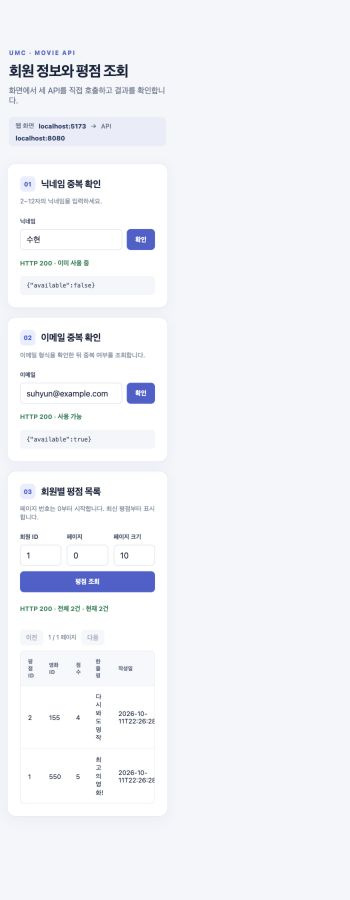
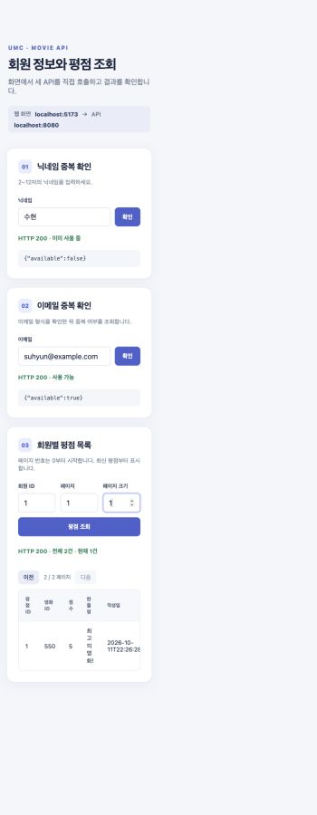
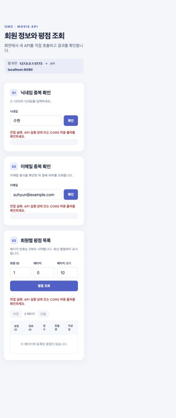

# Movie API 확인 화면

IntelliJ에서 `MovieApplication`을 실행한 다음, 이 디렉터리에서 아래 명령을 실행합니다.

```bash
python3 -m http.server 5173 --bind 127.0.0.1
```

브라우저에서 **http://localhost:5173**을 엽니다. 화면은 닉네임 중복 확인, 이메일 중복 확인, 회원별 평점 목록 API를 실제로 호출합니다. 평점 목록에서 `page`는 0부터 시작하고 `size`는 1~100입니다. 닉네임은 2~12자, 이메일은 이메일 형식이 아니면 DB 조회 전에 HTTP 400을 반환합니다.

## 실제 화면 캡처

허용된 `http://localhost:5173`에서 세 API가 모두 HTTP 200을 반환한 화면입니다.



페이지 크기를 1로 변경하고 두 번째 페이지를 조회한 화면입니다.



같은 화면을 `http://127.0.0.1:5173`에서 열면 API 응답을 읽지 못합니다.



## CORS 허용 범위

`allowedOrigins("*")`를 사용하면 어느 웹사이트에서 열린 화면이든 브라우저에서 이 API의 응답을 읽을 수 있습니다. 현재는 `http://localhost:5173`만 허용하므로, 캡처처럼 `http://127.0.0.1:5173`에서 연 동일한 화면은 요청이 차단됩니다. 출처는 프로토콜, 호스트, 포트의 조합이어서 `localhost`와 `127.0.0.1`도 서로 다른 출처입니다. 이 설정은 `/members/**` 경로의 `GET` 요청에만 적용하며, CORS는 브라우저의 응답 접근을 제어할 뿐 사용자 인증을 대신하지는 않습니다.
